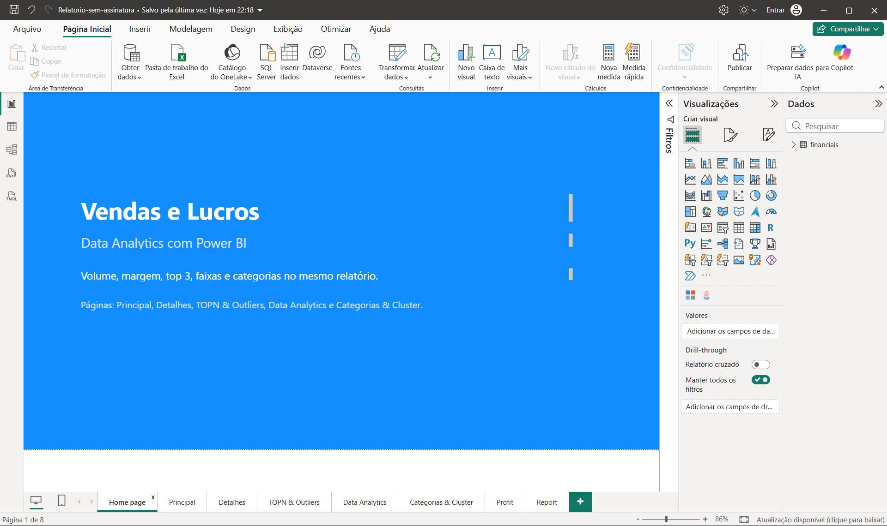
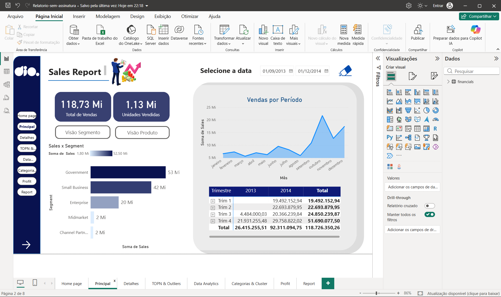
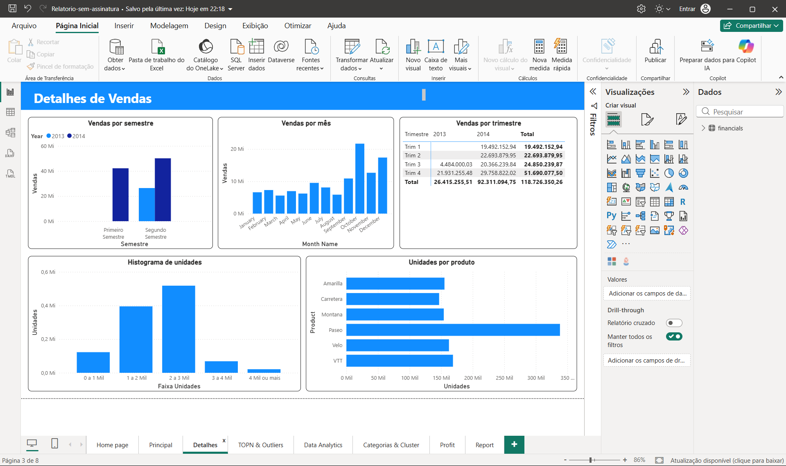
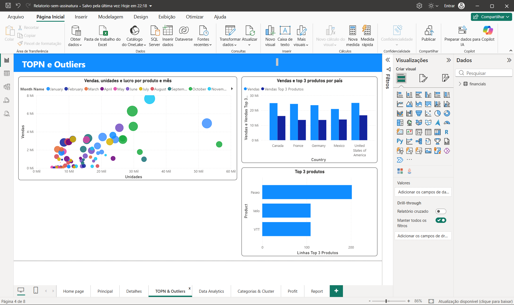
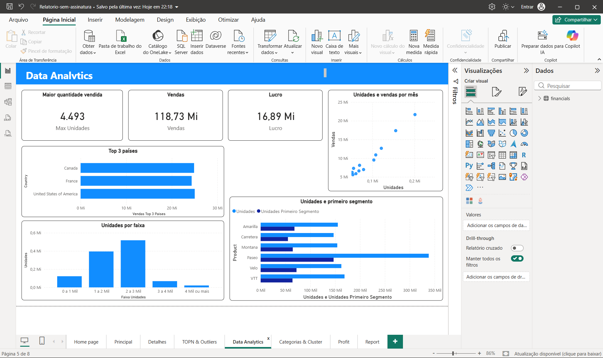
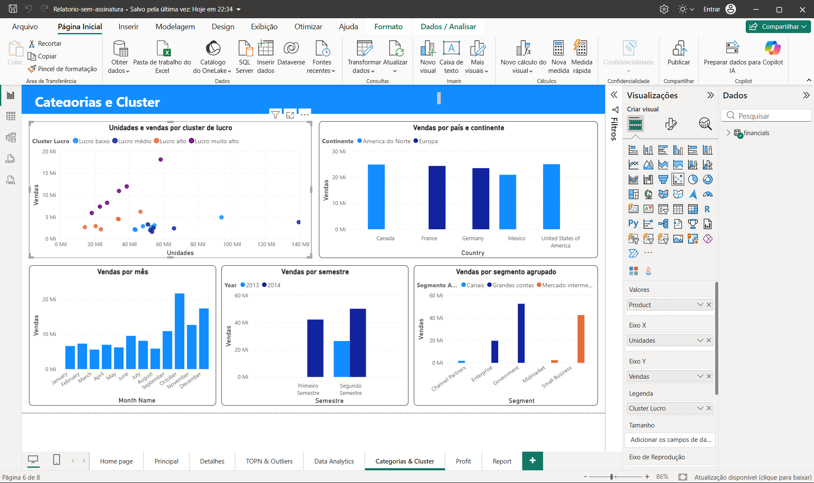
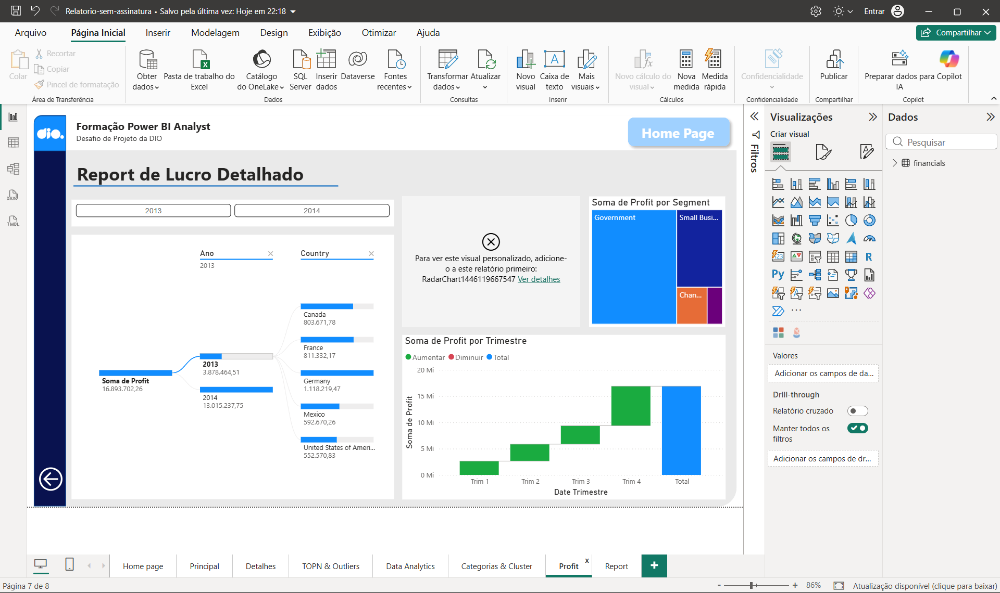
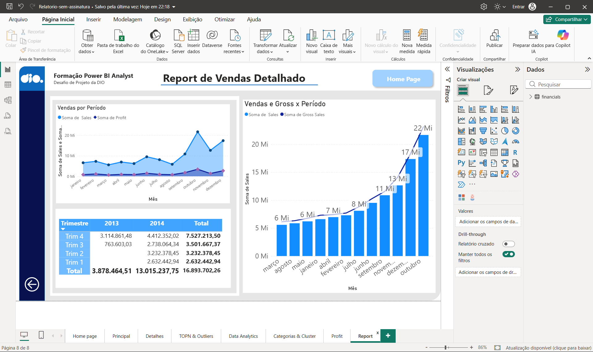

# Relatório de Vendas e Lucros com Data Analytics no Power BI

Relatório de vendas e lucros em oito páginas. A Home page abre a leitura. Principal mostra o volume. As páginas seguintes separam semestre, mês, ranking, faixas, continente e agrupamento de segmento.

## Objetivo

Organizar o relatório prático em páginas próprias de detalhe, ranking, análise e categorias, mantendo as páginas de lucro e de vendas que já vinham no arquivo. O arquivo de entrega é `Relatorio-Vendas-Lucros.pbix`.

## Como abrir

1. Abra o Power BI Desktop.
2. Em Arquivo, escolha Abrir e selecione `Relatorio-Vendas-Lucros.pbix`.
3. Use as abas no rodapé: Home page, Principal, Detalhes, TOPN & Outliers, Data Analytics, Categorias & Cluster, Profit e Report.

## Páginas

| Página | O que mostra |
| --- | --- |
| Home page | Capa com o título e a lista das páginas. |
| Principal | Volume de vendas: 118,73 milhões e 1,13 milhão de unidades, com período, segmento, trimestre e país. |
| Detalhes | Semestre, mês, trimestre, faixa de unidades e unidades por produto. |
| TOPN & Outliers | Unidades, vendas e lucro no mesmo gráfico, com o top 3 de produtos e de países. |
| Data Analytics | Máximo de 4.493 unidades, vendas de 118,73 milhões, lucro de 16,89 milhões e o segmento Government. |
| Categorias & Cluster | Continente, cluster de lucro e segmento agrupado em Grandes contas, Mercado intermediário e Canais. |
| Profit | Lucro por ano, trimestre e segmento. |
| Report | Vendas e lucro no período, com o total de lucro de 16,89 milhões. |

### Home page

### Principal

A página de volume. Government concentra a maior parte das vendas, seguido de Small Business.

### Detalhes

O semestre cruza 2013 e 2014. A faixa de 2 a 3 mil unidades é a mais frequente, e Paseo lidera a quantidade vendida.

### TOPN & Outliers

O gráfico de dispersão cruza unidades e vendas por mês, com o tamanho pelo lucro. Paseo, Velo e VTT formam o top 3 de produtos.

### Data Analytics

Os cartões separam o pico de unidades, o volume e o lucro. A barra compara cada produto com o segmento Government.

### Categorias & Cluster

Canada, Estados Unidos e Mexico ficam na América do Norte. France e Germany ficam na Europa. O segmento separa Grandes contas, Mercado intermediário e Canais.

### Profit

A árvore de decomposição abre o lucro por ano (2013 com 3,87 milhões e 2014 com 13,02 milhões), o waterfall segue o trimestre e o mapa de árvore mostra o segmento.

### Report

A área compara vendas e lucro mês a mês. O combinado cruza vendas e gross sales, com o pico em novembro.

## Leitura

O volume e o lucro ficam em páginas diferentes. Principal responde quanto foi vendido. Profit responde quanto sobrou. TOPN e Data Analytics mostram onde o volume se concentra, e Categorias mostra se essa concentração é de continente ou de tipo de cliente.
